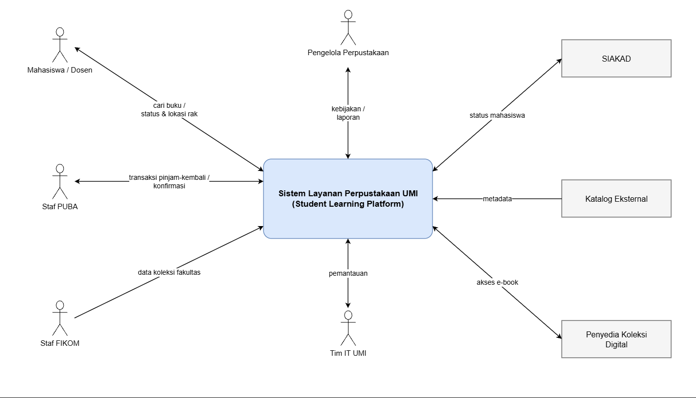
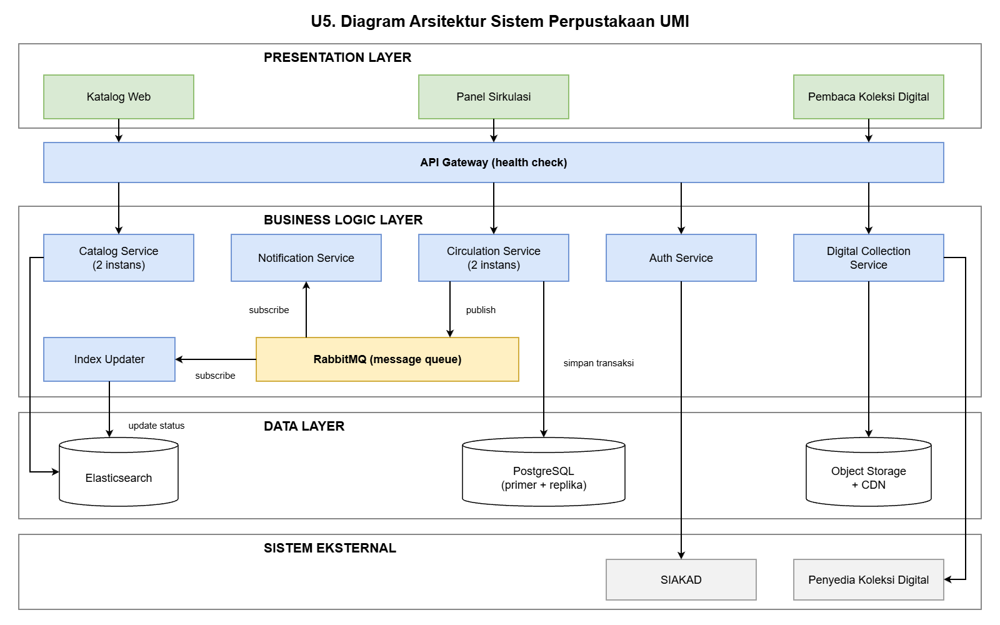
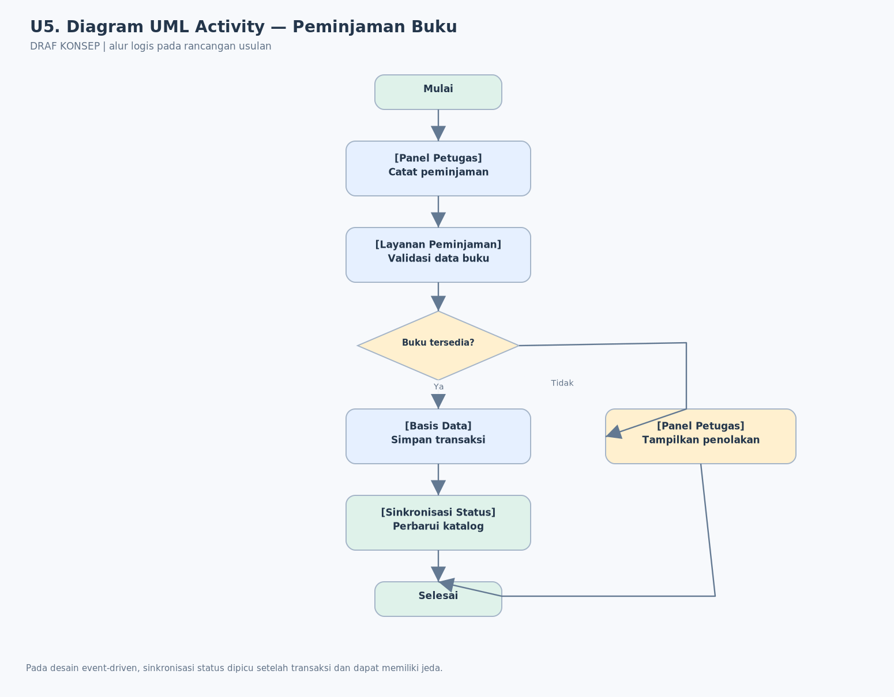

# U5. Desain dan Diagram

**BAB IV: Desain**  
**Penanggung jawab:** [isi sesuai pembagian MID]

**Ketentuan dosen:** minimal **3 diagram** (konteks, arsitektur yang menerapkan pola, UML), **masing-masing berketerangan**, serta **3 prinsip desain** yang diterapkan.

**PENTING:** Diagram PNG dan `.drawio` yang disertakan adalah **CONTOH RANCANGAN AWAL**. Semua komponen/arah hubungan harus disepakati kelompok, konsisten dengan U3/U4/U6/U7, dan belum berarti telah diimplementasikan.

## 5.1 Diagram konteks

**Keterangan diagram:** [siapa aktor eksternal, di mana batas sistem, data apa yang masuk/keluar; jelaskan masalah utama yang hendak diatasi].

**File edit:** `diagram/diagram-konteks.drawio`.

## 5.2 Diagram arsitektur yang menerapkan pola

**Keterangan diagram:** [jelaskan lapisan Portal/Panel, API, layanan domain, basis data, serta peran antrean event; tunjukkan Pola P-01 dan P-02 dan taktik U3].

**File edit:** `diagram/diagram-arsitektur.drawio`.

## 5.3 Diagram UML — Activity Diagram

**Keterangan diagram:** [jelaskan alur petugas mencatat peminjaman, validasi, perubahan status, dan pembaruan informasi katalog; sebut keputusan ketika buku tidak tersedia].

**File edit:** `diagram/diagram-uml-activity.drawio`.

## 5.4 Tiga prinsip desain yang diterapkan
| No | Prinsip desain | Contoh penerapan pada diagram | Manfaat |
|---|---|---|---|
| 1 | [misalnya Separation of Concerns] | [isi komponen] | [isi] |
| 2 | [misalnya Loose Coupling] | [isi komponen] | [isi] |
| 3 | [misalnya High Cohesion] | [isi komponen] | [isi] |

## 5.5 Konsistensi dengan U3, U4, U6, U7
- [ ] Nama komponen sama di setiap diagram dan teks.
- [ ] Taktik untuk tiga skenario terlihat/terwakili secara jelas.
- [ ] Dua pola dari U4 tampak pada diagram arsitektur.
- [ ] Jika pembaruan melalui event dapat terlambat, jelaskan pengendalian dan trade-off-nya.
- [ ] Rancangan terpilih digunakan konsisten pada evaluasi dan ADR.
